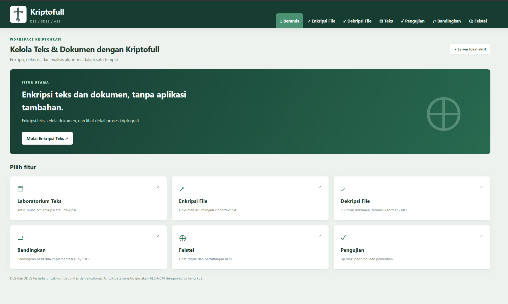
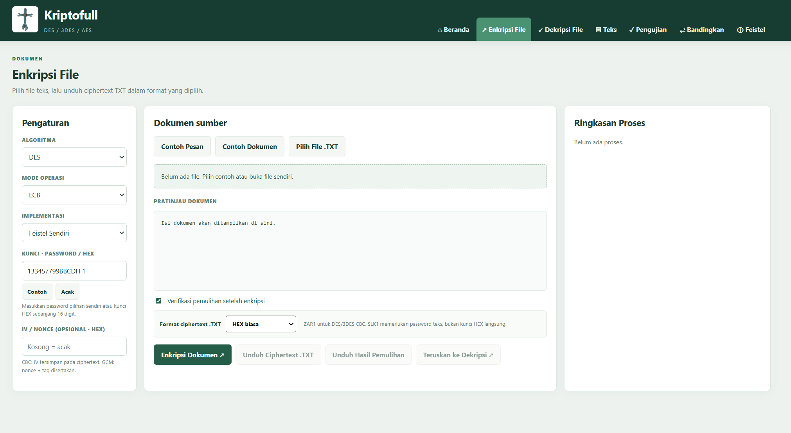
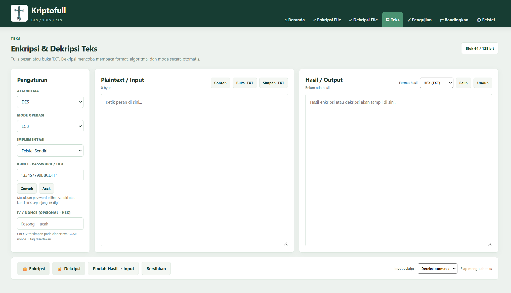
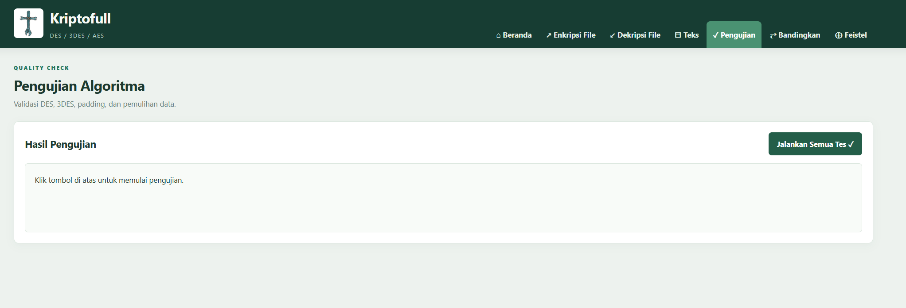
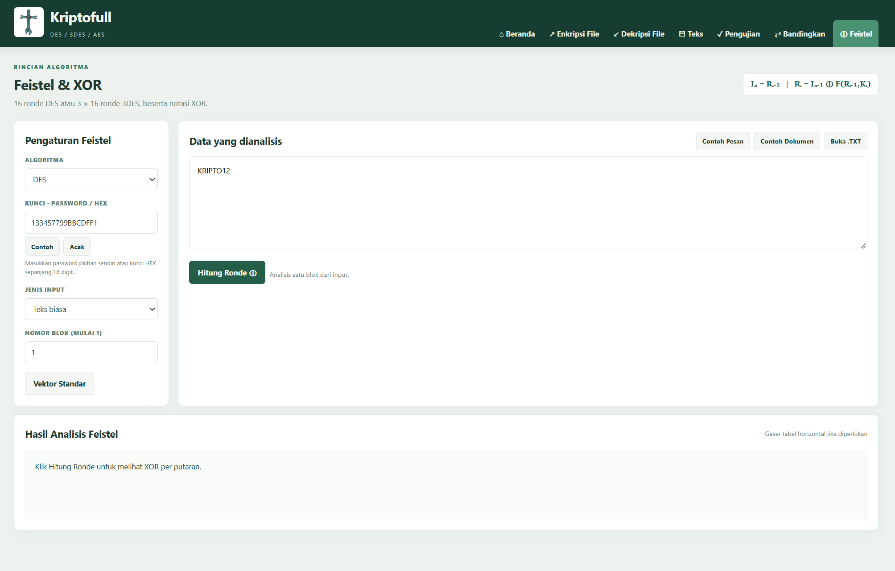

<h1 align="center">Kriptofull</h1>

<p align="center">
  <strong>Aplikasi kriptografi berbasis web untuk enkripsi, dekripsi, pengolahan file, dan analisis Feistel.</strong>
</p>

<p align="center">
  Mendukung algoritma <strong>DES</strong>, <strong>3DES</strong>, dan <strong>AES</strong> dalam satu aplikasi yang rapi, modern, dan mudah digunakan.
</p>

<p align="center">
  
  
  
  
</p>

---

## 📌 Deskripsi Singkat

**Kriptofull** adalah aplikasi kriptografi berbasis web yang dirancang untuk membantu pengguna melakukan:

- enkripsi teks,
- dekripsi teks,
- enkripsi file,
- dekripsi file,
- pengujian algoritma,
- perbandingan implementasi,
- serta analisis ronde **Feistel & XOR**.

Aplikasi ini dibuat agar pengguna dapat mengelola proses kriptografi dalam satu tempat dengan antarmuka yang sederhana namun tetap informatif.

---

## ✨ Fitur Utama

- **Enkripsi & dekripsi teks**
- **Enkripsi & dekripsi file**
- Dukungan algoritma **DES**, **3DES**, dan **AES**
- Dukungan **password / HEX key**
- Pilihan **mode operasi** seperti ECB dan CBC
- **Format output** ciphertext yang fleksibel
- **Deteksi otomatis** saat proses dekripsi teks
- **Analisis Feistel & XOR** per ronde
- **Pengujian algoritma** langsung dari aplikasi
- **Perbandingan hasil implementasi**
- Antarmuka web yang modern dan mudah digunakan

---

## 🖼️ Tampilan Aplikasi

## 1. Halaman Beranda
Halaman utama menampilkan ringkasan fungsi aplikasi dan pintasan menuju seluruh fitur utama Kriptofull.

<p align="center">
  
</p>

**Fungsi halaman ini:**
- menampilkan identitas aplikasi,
- memberikan gambaran singkat fungsi Kriptofull,
- menyediakan akses cepat ke menu:
  - Laboratorium Teks,
  - Enkripsi File,
  - Dekripsi File,
  - Bandingkan,
  - Feistel,
  - Pengujian.

---

## 2. Menu Enkripsi File
Menu ini digunakan untuk mengenkripsi file teks menjadi ciphertext dengan algoritma dan mode yang dipilih.

<p align="center">
  
</p>

**Fitur pada halaman ini:**
- memilih algoritma enkripsi,
- memilih mode operasi,
- memilih implementasi,
- memasukkan kunci dalam bentuk password atau HEX,
- memasukkan IV/nonce jika diperlukan,
- membuka file `.txt`,
- melihat pratinjau isi dokumen,
- memilih format ciphertext,
- melakukan enkripsi dokumen,
- mengunduh ciphertext hasil enkripsi,
- melakukan verifikasi pemulihan setelah enkripsi.

---

## 3. Menu Enkripsi & Dekripsi Teks
Menu ini dipakai untuk mengolah teks secara langsung tanpa harus melalui file.

<p align="center">
  
</p>

**Fungsi utama menu ini:**
- mengetik plaintext secara langsung,
- membuka file `.txt` untuk mengisi input,
- menyimpan teks atau hasil proses,
- memilih algoritma, mode, dan implementasi,
- memasukkan kunci kustom,
- mengenkripsi teks,
- mendekripsi ciphertext,
- memindahkan hasil output ke kolom input,
- membersihkan area kerja,
- memilih format hasil output,
- menggunakan **deteksi otomatis** saat dekripsi.

---

## 4. Menu Pengujian
Menu ini berfungsi untuk melakukan validasi implementasi algoritma yang ada di dalam aplikasi.

<p align="center">
  
</p>

**Kegunaan menu ini:**
- menguji apakah algoritma berjalan dengan benar,
- memvalidasi proses padding,
- memeriksa proses pemulihan data,
- menjalankan seluruh skenario pengujian secara otomatis,
- menampilkan hasil uji di dalam aplikasi.

Menu ini berguna untuk memastikan implementasi DES, 3DES, dan fitur terkait bekerja dengan baik.

---

## 5. Menu Feistel & XOR
Menu ini digunakan untuk melihat struktur kerja algoritma berbasis Feistel secara lebih rinci.

<p align="center">
  
</p>

**Fitur pada halaman ini:**
- memilih algoritma,
- memasukkan kunci,
- memilih jenis input,
- menentukan nomor blok yang dianalisis,
- menghitung ronde,
- melihat proses XOR,
- memahami pembagian dan transformasi data pada tiap ronde.

Menu ini sangat berguna untuk kebutuhan pembelajaran, analisis, dan pemahaman cara kerja kriptografi blok.

---

## 🧭 Struktur Menu Aplikasi

Kriptofull memiliki beberapa menu utama pada navigation bar:

### 1. Beranda
Menampilkan halaman utama aplikasi dan ringkasan fitur yang tersedia.

### 2. Enkripsi File
Digunakan untuk mengenkripsi file teks menjadi ciphertext sesuai algoritma dan mode yang dipilih.

### 3. Dekripsi File
Digunakan untuk memulihkan file ciphertext menjadi file asli/plaintext.

### 4. Teks
Digunakan untuk enkripsi dan dekripsi teks secara langsung.

### 5. Pengujian
Digunakan untuk menjalankan validasi terhadap implementasi algoritma.

### 6. Bandingkan
Digunakan untuk membandingkan hasil dari dua implementasi berbeda agar dapat dilihat konsistensi atau kesesuaiannya.

### 7. Feistel
Digunakan untuk melihat proses ronde Feistel dan pembuktian XOR.

---

## ⚙️ Teknologi yang Digunakan

Project ini dibangun menggunakan:

- **Python**
- **HTML**
- **CSS**
- **JavaScript**
- Implementasi algoritma:
  - DES
  - 3DES
  - AES
- Dukungan implementasi manual dan library crypto

---

## 📁 Struktur Project

Berikut struktur umum project Kriptofull:

```text
Kriptofull/
├── app.py
├── main.py
├── compare.py
├── des_own.py
├── des3_own.py
├── file_crypto.py
├── terminal_crypto.py
├── requirements.txt
├── README.md
├── CONTRIBUTING.md
├── SECURITY.md
├── .env.example
├── .gitignore
├── assets/
├── static/
├── tests/
└── docs/
    └── images/